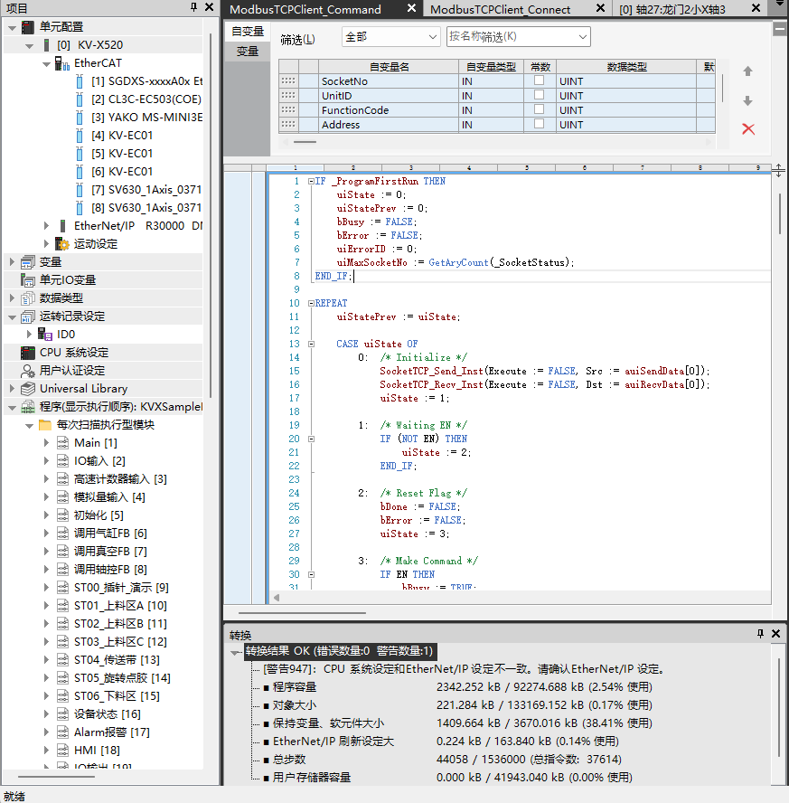
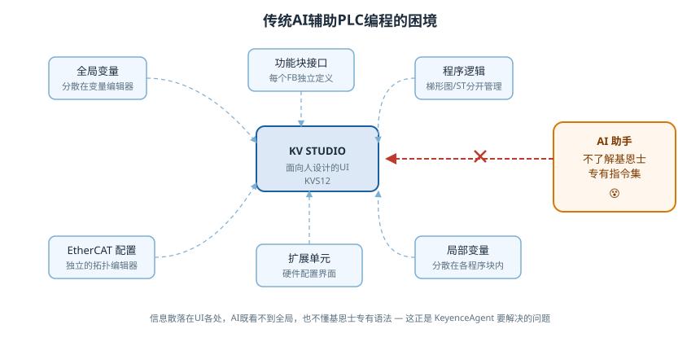
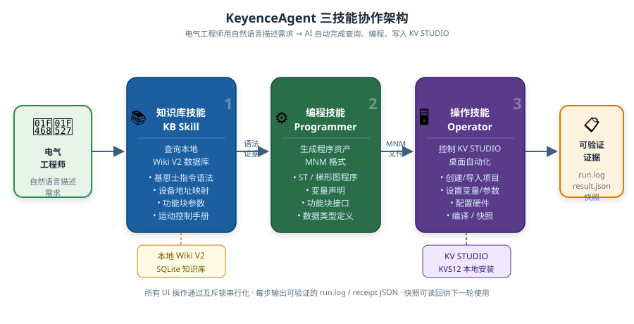
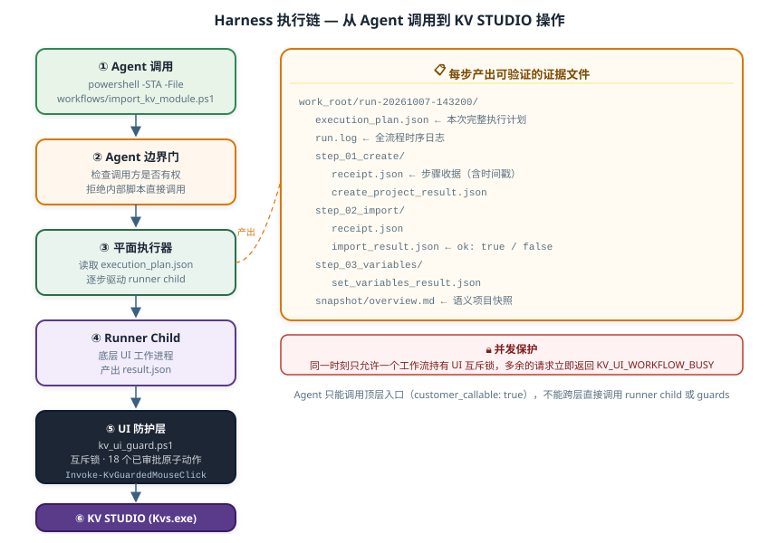
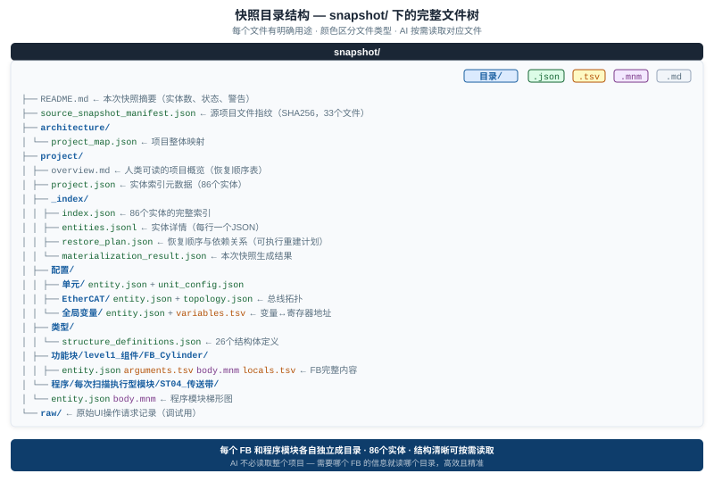
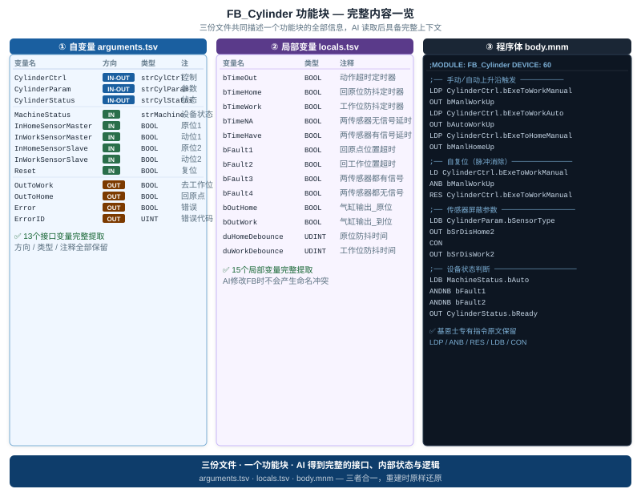
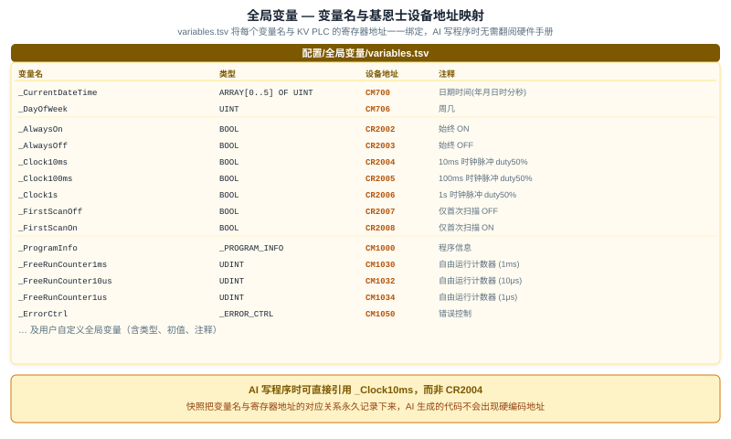
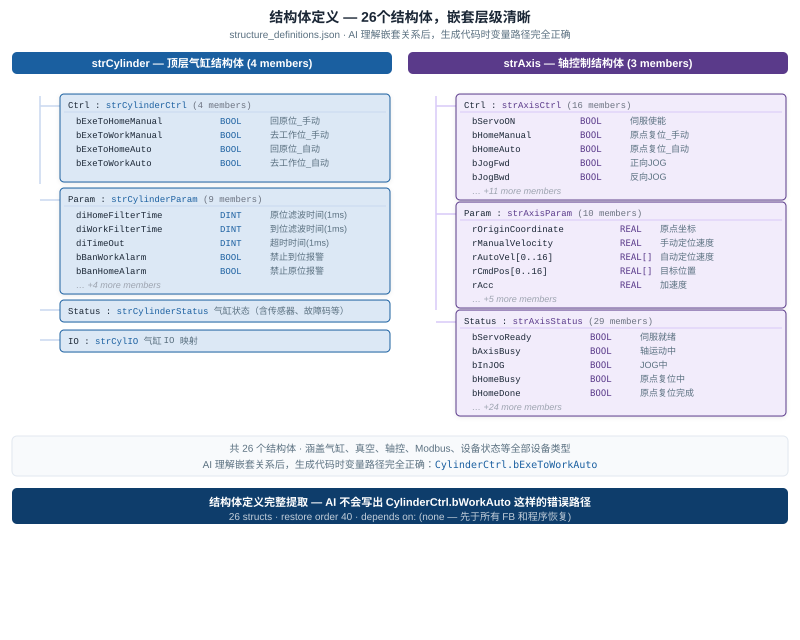
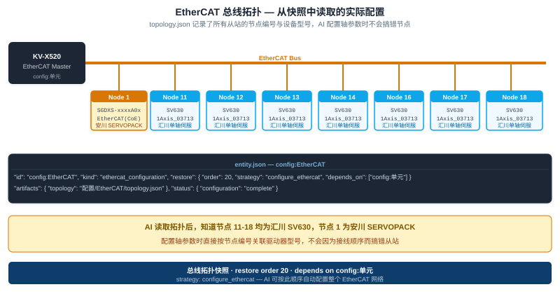
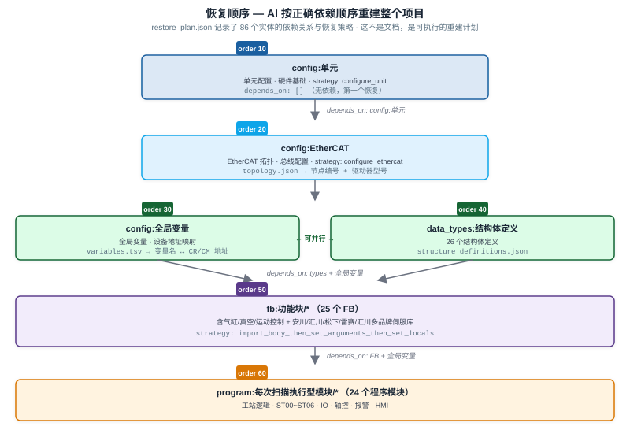

<div align="center">

# KeyenceAgent

**让 AI 真正读懂、写入 KV STUDIO**

*专为使用基恩士 PLC 的电气工程师设计 — 让 AI Agent 代你操作 KV STUDIO，你只需描述需求*

[](LICENSE)
[](#requirements)
[](#requirements)

</div>

---

## 这个项目是为谁准备的

如果你是使用**基恩士 KV 系列 PLC** 的电气工程师，你一定遇到过这些情况：

- 想让 AI 帮你写 ST 程序或梯形图，但 AI 根本不知道 `Z.RSTB`、`MC_MoveAbsolute` 这些基恩士专有指令怎么用
- KV STUDIO 的变量在一个地方，功能块接口在另一个地方，EtherCAT 配置又在别处 — AI 看不到这些，根本没法给出准确的方案
- 你想要的不是"AI 建议我怎么做"，而是 **AI 直接帮我把程序写进 KV STUDIO**

**KeyenceAgent 就是为解决这三个问题而生的。**

它不是给开发者搭 AI 框架用的，它是给**电气工程师**用的 — 一套让 AI Agent 能够真正理解基恩士知识、读取项目全局状态、并直接写入 KV STUDIO 的工具集。

---

## 里程碑：KV-X520 官方示例程序无人类参与复刻成功

<p align="center">
  
</p>

2026-10-28，KeyenceAgent 在没有人类参与操作 KV STUDIO 的情况下，完成了基恩士 **KV-X520 官方示例程序**（`KVX样例程序_v100`）的工程复刻：

- 自动重建 EtherCAT 拓扑：`SGDXS` ×1、`CL3C-EC503` ×1、`YAKO MS-MINI3E` ×1、`KV-EC01` ×3、`SV630` ×2
- 自动补齐 Modbus TCP 客户端功能块（`ModbusTCPClient_Connect` / `ModbusTCPClient_Command`）的接口与内部变量
- 自动执行转换：**转换结果 OK，错误数量 0**，总步数 44058

需要诚实说明的边界：

- 复刻目标是**可编译、结构对齐的工程**，不保证每个参数都与源程序逐项一致；轴参数、PDO 映射、`KV-EC01` 的模块分配（示例为 2/6 modules）等可能存在差异
- 目前只验证到 **KV STUDIO 转换通过 + 工程文件回读**，**未在实体 PLC 上运行验证**，也没有做实际 IO / 运动联调
- 示例中的预留轴、注释和部分显示名可能与原工程不同

---

## 问题：KV STUDIO 是面向人设计的

<p align="center">
  
</p>

KV STUDIO 的设计目标是让**工程师通过鼠标操作**完成工作。这意味着：

- **全局变量**在变量编辑器里，**局部变量**藏在每个程序块内部
- **功能块接口**需要逐个打开才能看到
- **EtherCAT 配置**在独立的拓扑编辑器中
- **扩展单元**在另一个硬件配置界面

没有任何一个地方能让 AI 看到项目的全貌。加上基恩士有大量专有指令（如 `Z.RSTB`、`MC_MoveAbsolute` 的 KV 特定用法），AI 仅凭通用 IEC 61131-3 知识根本无法给出正确代码。

---

## 解决方案：三个技能协同工作

<p align="center">
  
</p>

KeyenceAgent 把问题分成三层，每层一个技能：

| 技能 | 职责 | 解决什么问题 |
|------|------|-------------|
| **知识库技能** `kv-studio-kb-programming` | 查询本地基恩士知识库（Wiki V3m） | AI 不知道基恩士专有指令 |
| **编程技能** `keyence-plc-programmer` | 生成 MNM 格式程序文件、变量声明、功能块接口 | AI 无法生成正确的 KV STUDIO 程序格式 |
| **操作技能** `kv-studio-operator` | 直接操作 KV STUDIO 桌面 | AI 无法读取/写入散落各处的项目信息 |

三个技能配合形成完整的闭环：**查 → 写 → 导入 → 验证**，每一步都产生可检查的证据文件（`run.log`、`result.json`、项目快照）。

---

## 知识库（Wiki V3m）：里面有什么

知识库是一个本地 SQLite（`wiki.v3m.db`，约 450 MB）+ 一份 bge-m3 向量矩阵，由 [`kb-pipeline/`](kb-pipeline/) 从下列资料编译而来。
**数据库不进 git**（体积太大），通过项目网盘分发，放到配置里的 `wiki_root` 即可。

### 资料构成

| 资料 | 来源 / 说明 | 是否本次新增 |
|------|------------|-------------|
| **参考手册 155 本** | 随 KV STUDIO KVS12 安装的 `ManualHelp\2052`：CPU/单元手册、指令参考（KVSREF）、运动控制（KvsMotion）、通信（EtherNet/IP、EtherCAT、串口）、定位单元、模拟量/温度/高速计数单元、伺服手册等 | 原有 |
| **乱码页修复** | 这些 PDF 有 **22%（5,970 页）文字层是字体编码乱码**；`wiki.v3m.db` 用 MinerU 重新识别了 6,305 页、替换 1,837 个父块（约 2,656 块），被替换的块乱码残留为 0 | 原有（v3m 的核心差异） |
| **T 语言示例程序 57 个** | `T语言示例/P28–P127 + ST_Sample.mnm`，带完整 ST 代码 | 原有 |
| **教材 3 本** | 《使用实例！ST 语言》(140p，67 个常用函数 + 现场实例)、《程序标准化：变量、ST、FB 篇》(92p)、《PLC 编程教材 运动控制篇》(92p)；**PDF 用 MinerU standard 档识别，不用 Python 直接抽文本** | 新增 |
| **官方示例程序 2 套** | `SH04PL轴控程序示例`（20 个 .mnm：原点回归、JOG、示教、绝对值跟随、运行中改速/改坐标、连续启动、M 代码输出…）、`常用主模块程序`（44 个 .mnm：数组移位、平均值/方差、累计、Ping 连通检查、时间戳、边沿检测…，LD 与 ST 双版本） | 新增 |
| **标准化工程快照** | 基恩士公开的 `KVX样例程序_v100`：40 个 FB（四品牌伺服参数读写/初始化/软件复位/型号检查、ABS 编码器设定、ModbusTCP 客户端、level1 组件 Cylinder/Motion/Vacuum、level3 设备 McMode）+ 24 个执行型程序模块 + 结构体 + 全局变量表；每个 FB 都带自变量、局部变量和程序体 | 新增 |
| **本体卡片 2,162 张** | 481 功能块 / 281 指令 / 44 单元 / 1,342 概念 / 6 错误码 / 8 实机验证经验，全部挂证据块 | 原有（本次重建） |
| **同义词 1,683 对** | 761 个中文说法 → 620 个真实存在的目标词（含并查集同义组、df 过滤、中文否定保护） | 原有（本次扩容） |
| **知识库说明 3 条** | 变量命名规范对照（教材 vs 样例程序）、资料构成、标准程序分层结构 | 新增 |

### 规模

- 文本块 **53,146**；其中参考手册与表格约 5.2 万，教材/示例/快照/说明 354 块
- 向量：18,979 个块 + 2,148 张卡片的 bge-m3 向量（1024 维）
- 检索：四通道融合（jieba 词级 BM25 / 字符三元组 / 标识符精确名匹配 / 稠密向量 + 卡片通道），单次查询约 130–190 ms

### 当前检索质量（2026-11-03）

| 评测集 | 说明 | hit@5 | hit@1 |
|--------|------|-------|-------|
| `cases_holdout.jsonl` | 50 条，写于同义词调参之前 | 0.98 | 0.80 |
| `blind_120.jsonl` | 120 条，四类领域，子代理读手册出题 | 0.90 | 0.58 |
| `sealed_60.jsonl` | 60 条，最后写、只做确认 | 0.83 | 0.65 |

评测集在 `kb-pipeline/benchmark/`，跑法见 [kb-pipeline/PROGRESS.md](kb-pipeline/PROGRESS.md)（含每轮改动、消融数据和踩坑记录）。

### 重建知识库

```powershell
cd kb-pipeline
python stage1_clean_chunk.py --mineru --dst <wiki_root>\v3\wiki.v3m.db   # 清洗切块 + MinerU 文本
python ingest_extra.py                                                    # 教材 / 示例程序 / 工程快照
python stage2_index.py   --db <wiki_root>\v3\wiki.v3m.db                  # FTS + 同义词 + df
python stage4_cards.py   --db <wiki_root>\v3\wiki.v3m.db                  # 本体卡片
python stage5_vectors.py --db <wiki_root>\v3\wiki.v3m.db --model bge-m3   # 向量
```

耗时参考：stage1 ~10 s、stage2 ~4 min（含 df 扫描）、stage4 ~5 s、stage5 ~3 min（RTX A4000）。
教材 PDF 需要先用 MinerU 解析（`mineru-kit parse <pdf> -o kb-pipeline/extra_docs/mineru/<key> --tier standard`）。

### 引用原则

检索结果会带 `source_type`，不同类型证据的效力不同，**不能互相替代**：

- `htmlhelp` / `chm` / `pdf`：**手册**，讲语法与约束 —— 是最终依据
- `textbook`：**教材**，讲方法与步骤（怎么写、怎么组织）
- `program_example` / `project_snapshot`：**参考实现**，看真实工程里怎么写
- `kb_note`：库维护者写的说明（命名规范、资料构成、分层结构）

注意变量命名规范在资料里是**两套**：教材用 `x/ui/i/r/a/st/fb` + `g/l` 作用域前缀，`KVX样例程序_v100`
用的是 `b/inst/str` + 中文全局名。回答命名问题时要说明用的是哪一套，`kb_note` 里有对照表。

---

## 典型工作流

```
电气工程师说：
  "给 KV-X310 新建一个项目，实现一个 FB：
   输入轴当前位置，输出是否在目标范围内的 BOOL 信号"

AI Agent 自动完成：
  1. [知识库技能]
     查 MC_MoveAbsolute、位置比较指令的基恩士专有用法
  2. [编程技能]
     生成 ST 程序体 MNM，以及分开的 FB 自变量 TSV
     局部变量和全局变量 TSV
  3. [操作技能]
     ① 创建项目
     ② 导入 MNM
     ③ 写入 FB 自变量
     ④ 写入局部变量
     ⑤ 设置全局变量
     ⑥（需要调用时）创建实例并绑定实参
     ⑦ 编译
  4. [输出]
     run.log、编译结果 JSON、项目快照

说明：MNM 主要承载程序体；FB 自变量、局部变量和全局变量由各自的 TSV 写入并回读。
需要由调用程序使用 FB 时，还要创建实例并完成实参绑定，不能把“导入 MNM”当作声明已经完成。

工程师检查结果，KV STUDIO 里已经有了完整的程序。
```

### Harness 执行链

每次调用工作流，都经过严格的六层执行链。Agent 只能进入最顶层的 `customer_callable` 入口，内部各层对外完全不可见，所有 UI 操作通过互斥锁串行化：

<p align="center">
  
</p>

### 快照：让 AI 看到项目全貌

调用 `export_kv_project_text_snapshot` 工作流，将散落在 KV STUDIO 各处的信息统一导出为结构化语义快照。以下六张图展示了一个真实项目（KVX样例程序，含多品牌伺服电机库、ModbusTCP、工站程序）快照的实际内容：

**快照目录结构**

<p align="center">
  
</p>

**功能块完整内容：自变量 + 局部变量 + 程序体**

<p align="center">
  
</p>

**全局变量与基恩士设备地址映射**

<p align="center">
  
</p>

**结构体定义（26个，含嵌套层级）**

<p align="center">
  
</p>

**EtherCAT 总线拓扑**

<p align="center">
  
</p>

**实体依赖与恢复顺序**

<p align="center">
  
</p>

---

## 快速开始

### 环境要求 {#requirements}

- Windows 10 / 11
- Windows PowerShell 5.1
- KEYENCE KV STUDIO KVS12（已安装 `Kvs.exe`）
- Codex AI Agent 运行时
- 基恩士知识库 `wiki.v3m.db`（约 450 MB）+ 向量矩阵（约 40 MB），从项目网盘获取后放到 `wiki_root`，见上文「知识库（Wiki V3m）」

### 安装

```powershell
# 克隆项目
git clone https://github.com/xxrust/KeyenceAgent.git
cd KeyenceAgent

# 一键安装检查
powershell -ExecutionPolicy Bypass -File setup_keyence_agent.ps1
```

### 配置

在 `%APPDATA%\Codex\kv-studio-operator\` 下创建 `config.json`：

```json
{
  "kvs_exe": "C:\\Program Files\\KEYENCE\\KV STUDIO\\Kvs.exe",
  "work_root": "C:\\KvAgentWork",
  "admin_credential_path": "%APPDATA%\\Codex\\kv-studio-operator\\credentials.xml",
  "admin_user_default": "Administrator",
  "wiki_root": "D:\\KeyenceWiki"
}
```

> 参考模板：[`kv-studio-operator/config/kv-studio-operator.example.json`](kv-studio-operator/config/kv-studio-operator.example.json)

---

## 项目结构

```
KeyenceAgent/
├── kv-studio-kb-programming/   技能1：查询基恩士知识库
│   └── scripts/                kb_search.py（检索入口）、kb_vectors.py、kb_rerank.py
├── keyence-plc-programmer/     技能2：生成 PLC 程序文件
├── kv-studio-operator/         技能3：操作 KV STUDIO 桌面
│   ├── scripts/workflows/      对外发布的工作流（Agent 唯一入口）
│   ├── scripts/guards/         UI 原子操作防护层
│   ├── scripts/runner_children/ 底层 UI 执行器（内部）
│   └── config/                 配置模板
├── kb-pipeline/                知识库构建流水线（切块/索引/卡片/向量）
│   ├── stage1..stage5_*.py     五个构建阶段
│   ├── ingest_extra.py         教材 / 示例程序 / 标准化工程入库
│   ├── synonyms.tsv            同义词表（1,683 对，0 个死目标）
│   ├── benchmark/              评测集与跑分脚本
│   └── PROGRESS.md             全部数值、消融与踩坑记录
├── docs/                       文档、指南、架构图
├── scripts/                    安装与开发辅助脚本
└── tests/                      回归测试
```

详细的技能说明和工作流文档见 **[Wiki](docs/wiki/)**。

---

## 当前能力状态

| 功能 | 状态 |
|------|------|
| 创建项目、导入 MNM、设置变量 | ✅ 已验证发布 |
| 用户功能块 (FB) 导入与参数配置 | ✅ 已验证发布 |
| ST 数值型 FB 创建（KV-X520） | ✅ 已验证发布 |
| BOOL 梯形图完整模块 | ✅ 已验证发布 |
| 项目快照（全量语义读取） | ✅ 已验证发布 |
| MNM 导出 | ✅ 已验证发布 |
| 结构体类型定义 | ✅ 已验证发布 |
| 扩展单元配置 | ✅ 已验证发布 |
| EtherCAT 节点配置 | ✅ 已验证发布 |
| 新建项目 / 编译（独立工作流） | 🔄 pending_validation |

---

## 贡献

见 [CONTRIBUTING.md](CONTRIBUTING.md)。

## License

[MIT](LICENSE)
